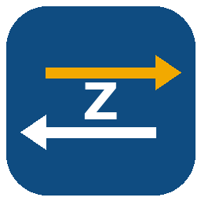

# PTG Zoho Sync - downloads

Windows desktop app by **PTG Consultant LLC** that syncs **Odoo**, **Microsoft Dynamics 365 Business
Central** and **QuickBooks Desktop** with **Zoho Books**, in both directions:

* sales invoices, credit notes, customers and payments go to Zoho Books;
* e-invoice statuses (Zoho as the UAE e-invoicing ASP) and supplier bills come back into your ERP.

## Download and install
1. Open **[Releases](../../releases/latest)** and download **`PTG-Zoho-Sync-Setup-<version>.exe`**.
2. Run it. You don't need administrator rights. If Windows SmartScreen shows *"Windows protected your PC"*,
   click **More info → Run anyway**: the installer isn't code-signed yet.
3. Start **PTG Zoho Sync** from the Start menu or the desktop shortcut, then follow the
   **Overview** page: Source ERP → Zoho Books → Settings & tax mapping → Preview → Sync now.

Requirements: Windows 10 or 11 (64-bit). For QuickBooks Desktop, use version 2022 or newer, on the same PC.

**Updating:** run the newer Setup.exe. Your profiles, keys and sync history in
`%APPDATA%\OdooZohoSync` are kept. **Uninstalling** (Settings → Apps) keeps them too.

Each release also has a `.sha256` file you can use to check the download:
`Get-FileHash .\PTG-Zoho-Sync-Setup-<version>.exe` in PowerShell.

Support: PTG Consultant LLC, Dubai, https://ptgconsultant.com

This repository holds the installers only. The source code is private.

## All versions
Each installer is also kept in the [installers](installers) folder.
